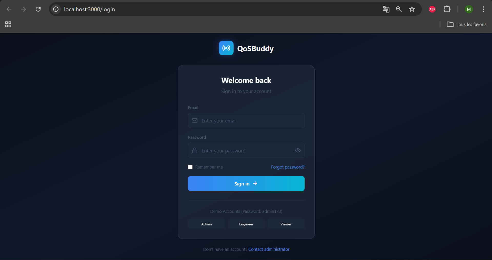
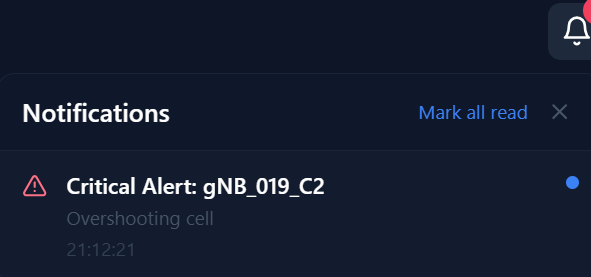
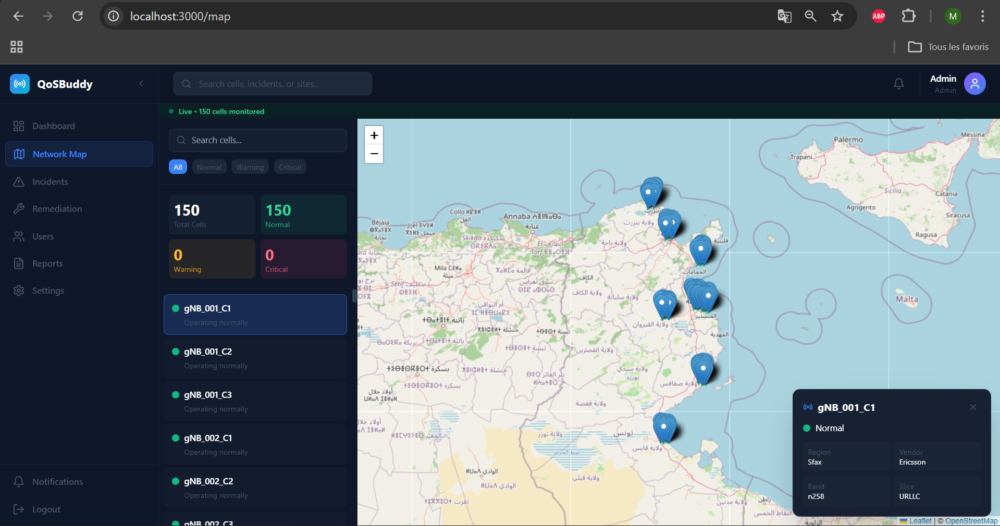
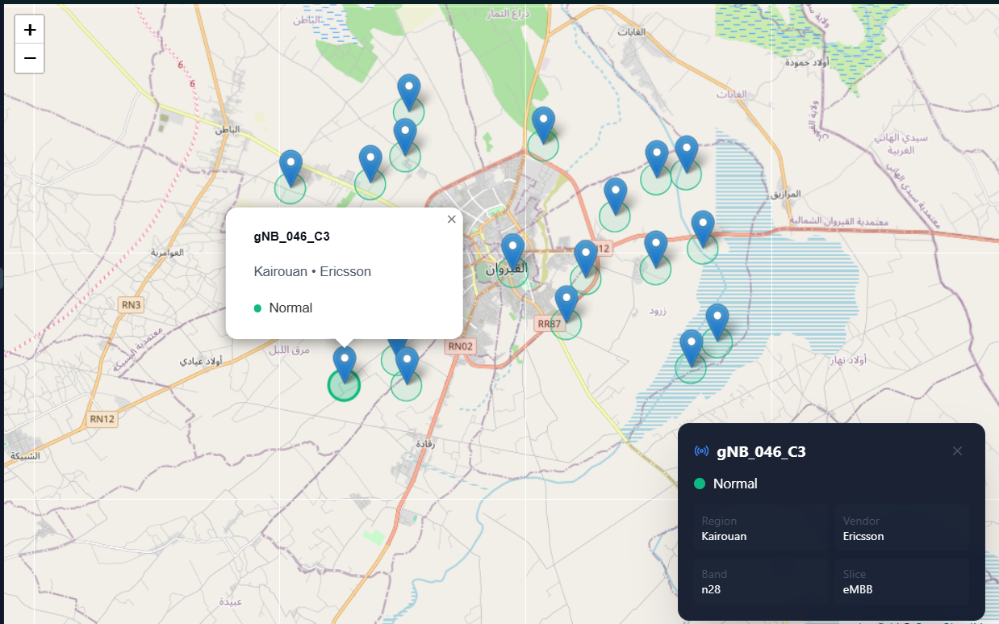
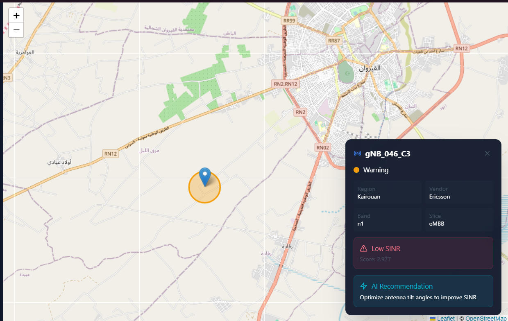
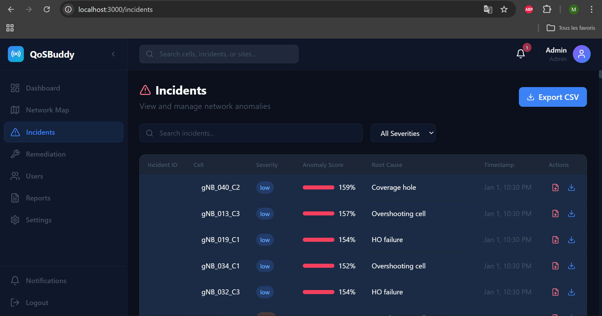
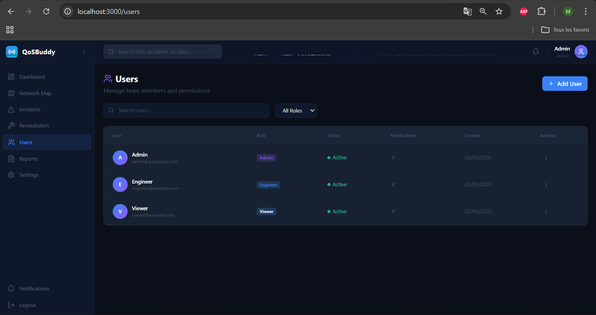
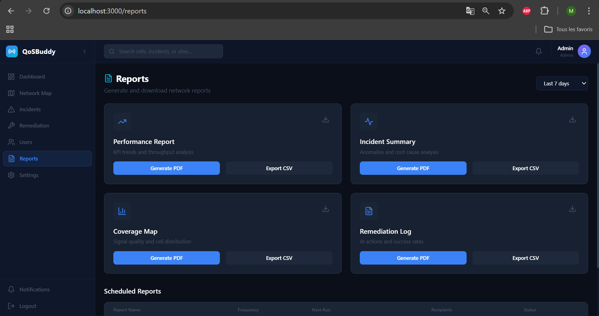
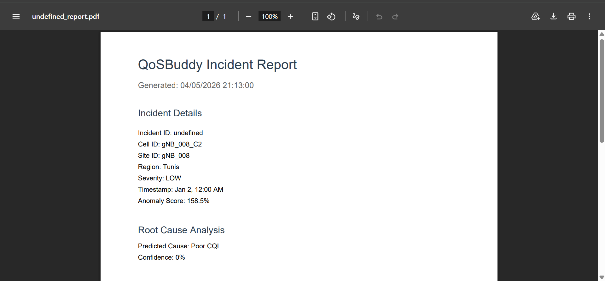

# QoSBuddy Web Dashboard

A Next.js 14 React web application for real-time 5G network quality monitoring, anomaly detection visualization, and incident management.

## Framework & Tech Stack

- **Framework**: [Next.js 14](https://nextjs.org/) (App Router)
- **Language**: TypeScript
- **Styling**: Tailwind CSS with custom navy/dark theme
- **UI Components**: Lucide React icons
- **Maps**: Leaflet + React-Leaflet
- **PDF Generation**: jsPDF
- **Real-time**: WebSocket (custom hook)
- **Database**: MySQL2 (for auth/users)

## Quick Start

```bash
# Install dependencies
npm install

# Run development server
npm run dev

# Build for production
npm run build
```

The dashboard runs on `http://localhost:3000` by default.

## Project Structure

```
app/
├── api/                    # Next.js API routes
│   ├── auth/login/         # Authentication endpoint
│   └── cells/              # Cell topology API (reads from CSV)
├── dashboard/
│   ├── page.tsx            # Main dashboard (real-time metrics)
│   └── realtime-page.tsx   # Live WebSocket event stream
├── incidents/
│   └── page.tsx            # Incident reports list + PDF download
├── map/
│   ├── page.tsx            # Map view wrapper
│   └── real-map.tsx        # Leaflet map with cell pins
├── globals.css             # Tailwind config + custom theme
├── layout.tsx              # Root layout with providers
└── page.tsx                # Login page (redirects to dashboard)

components/
├── Header.tsx              # Top nav with notification bell
├── Sidebar.tsx             # Left navigation menu
└── KpiCard.tsx             # Metric display cards

lib/
├── notifications.ts        # React hook for notifications
├── websocket.ts            # WebSocket client hook
├── db.ts                   # MySQL connection & schema
├── data.ts                 # TypeScript interfaces + mock data
└── utils.ts                # Helper functions

public/                     # Static assets
```

## Key Features Implemented

### ✅ Working
- **Authentication**: Login with admin@qosbuddy.com / admin123
- **Real-time Dashboard**: Live WebSocket feed from detection agent (ws://localhost:8765)
- **Map Visualization**: All 150 cells from cell_topology.csv with certified Tunisian coordinates
- **KPI Cards**: Total events, anomalies, critical alerts, auto-remediated count
- **Incident Reports**: List view with search/filter, PDF and JSON download
- **PDF Generation**: Full incident reports with RCA, KPI snapshot, remediation steps
- **Notification UI**: Bell icon with dropdown (visual only - see pending)

### 🔧 Partially Working
- **Map Cell Display**: Shows all 150 cells from API, but pins may overlap at certain zoom levels
- **Severity Colors**: Normal/Warning/Critical status based on WebSocket events

## Known Issues & Pending Improvements

### 🔴 Critical (Needs Fix)

1. **Notifications Don't Work**
   - The notification bell UI exists but alerts aren't being triggered
   - WebSocket events arrive but don't create browser notifications
   - Need to connect `useNotifications()` hook to actual WebSocket event handler
   - Should show toast/popup when critical/high severity events arrive

2. **Map Performance with 150 Cells**
   - All 150 pins render but may cause lag on lower-end devices
   - Pins overlap in dense areas (clustering needed)
   - Need to implement marker clustering or lazy loading

3. **WebSocket Port Mismatch**
   - Dashboard tries ws://localhost:8085 in some places, ws://localhost:8765 in others
   - Detection agent runs on 8765, remediation on 8080
   - Need consistent port configuration

### 🟡 Medium Priority

4. **Deployment Configuration**
   - Currently hardcoded for localhost
   - Need environment variables for:
     - WebSocket URLs
     - Database connection
     - API endpoints
   - Vercel deployment guide needed

5. **Report Enhancements**
   - PDF reports work but styling is basic
   - Could add charts/graphs to PDFs
   - Bulk export (multiple incidents as single PDF)
   - Email report functionality

6. **Cell Info Panel**
   - Clicking map pins shows popup but limited info
   - Should show full cell topology data (tilt, azimuth, neighbors)

### 🟢 Future Additions

7. **User Management**
   - Currently only hardcoded admin user
   - Need user CRUD, roles (admin/engineer/viewer)

8. **Historical Analytics**
   - Time-series charts for KPI trends
   - Anomaly frequency by cell/region

9. **Alert Configuration**
   - User-defined alert thresholds
   - Email/SMS notification settings

10. **Mobile Responsiveness**
    - Sidebar doesn't collapse on mobile
    - Map controls need touch optimization

## Environment Variables (To Add)

Create `.env.local`:

```env
# Database
DB_HOST=localhost
DB_USER=root
DB_PASSWORD=your_password
DB_NAME=qosbuddy

# WebSocket
NEXT_PUBLIC_WS_URL=ws://localhost:8765
REMEDIATION_WS_URL=ws://localhost:8080

# API
NEXT_PUBLIC_API_URL=http://localhost:3000/api
```

## Deployment Guide (Draft)

### Vercel
1. Push to GitHub
2. Connect repo to Vercel
3. Set environment variables
4. Update WebSocket URLs to use wss:// for production
5. Note: WebSocket requires paid plan or custom server setup

### Self-Hosted (Recommended for WebSocket)
```bash
npm run build
npm start
# Or use PM2 for production
```

## File Explanations

| File | Purpose |
|------|---------|
| `app/api/cells/route.ts` | API that reads cell_topology.csv and serves to map |
| `app/map/real-map.tsx` | Main map component - fetches cells via API, renders Leaflet |
| `app/incidents/page.tsx` | Incident list + detail panel + PDF/JSON download |
| `lib/websocket.ts` | Custom hook for WebSocket connection to detection agent |
| `lib/notifications.ts` | Notification state management (needs WebSocket integration) |
| `components/Header.tsx` | Top bar with notification bell and user dropdown |

## Development Notes

- WebSocket connection requires detection agent to be running
- Map fetches cell topology on mount (shows loading spinner)
- PDF generation happens client-side (jsPDF)
- Database auto-migrates on first login
## Screenshots
- Authentication

- Dashboard
- notification

- Map



- Incidents

- Remediation
- Users

- Reports


---

**Last Updated**: May 2026
**Status**: Beta - Core features working, polish and deployment pending
